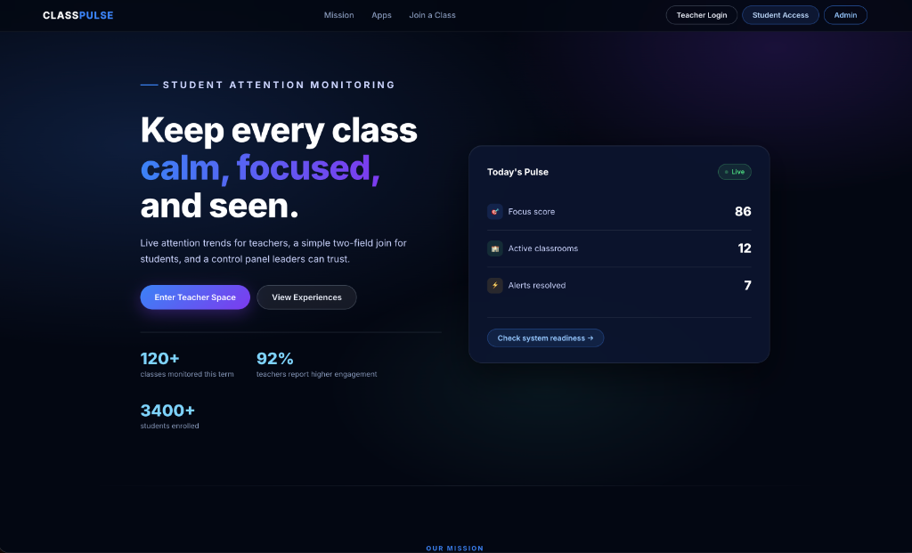
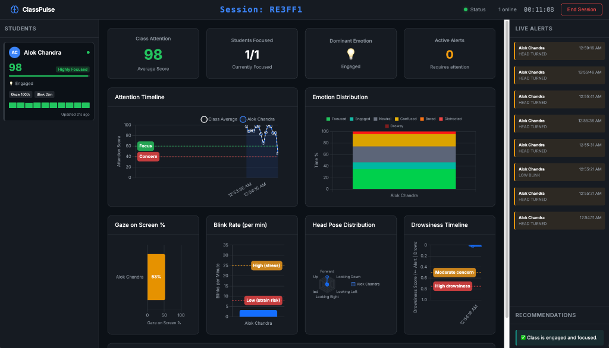
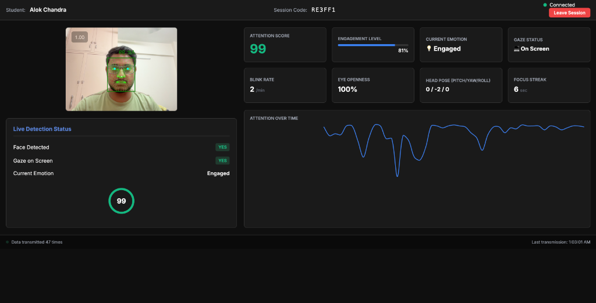
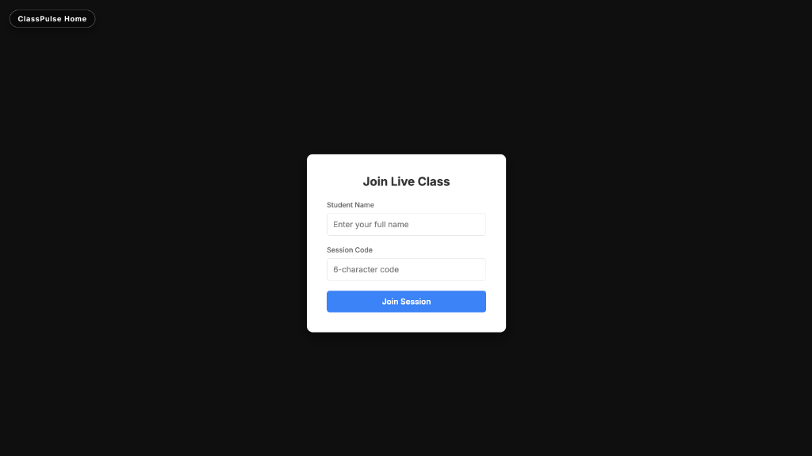

<p align="center">
  <h1 align="center">🎓 ClassPulse — Student Attention Monitoring System</h1>
  <p align="center">
    <strong>Real-time AI-powered attention tracking for modern classrooms</strong>
  </p>
  <p align="center">
    <a href="#-features">Features</a> •
    <a href="#-screenshots">Screenshots</a> •
    <a href="#-quick-start">Quick Start</a> •
    <a href="#-architecture">Architecture</a> •
    <a href="#-tech-stack">Tech Stack</a>
  </p>
</p>

---

## 📖 About

**ClassPulse** is a comprehensive student attention monitoring system that uses computer vision and AI to track student engagement in real-time during live classes. Teachers get a rich analytics dashboard while students simply join with a name and session code — their webcam feed is analyzed locally for attention score, emotion, gaze direction, blink rate, head pose, and drowsiness.

The system is designed as a monorepo containing four applications: a **Control Hub** (landing page), a **Student Client** (capture & monitoring), a **Teacher Dashboard** (analytics & alerts), and a **REST + WebSocket API** that ties everything together.

---

## ✨ Features

| Category | Highlights |
|---|---|
| 🧠 **AI-Powered Analysis** | Real-time face detection, gaze tracking, emotion recognition, blink rate monitoring, head pose estimation, and drowsiness detection |
| 📊 **Teacher Dashboard** | Live attention timeline, emotion distribution charts, gaze & blink analytics, head pose visualization, drowsiness tracking, and smart alerts |
| 🎥 **Student Client** | Webcam-based face mesh tracking, live attention score, engagement level, focus streaks, and attention-over-time graphs |
| 🔔 **Live Alerts** | Instant notifications for head turns, low blinks, drowsiness, and other attention events |
| 💡 **Smart Recommendations** | AI-generated class-level engagement recommendations for teachers |
| 🌐 **Real-time Sync** | Socket.IO-powered live data transmission between students and teacher |
| 🏠 **Control Hub** | Beautiful landing page with system readiness checks, live pulse stats, and role-based navigation |

---

## 📸 Screenshots

### 🏠 Control Hub — Landing Page
The central entry point with live system stats, role-based navigation for Teachers, Students, and Admins, and a modern dark-themed UI.

<p align="center">
  
</p>

---

### 📊 Teacher Dashboard — Live Session Monitoring
A comprehensive real-time analytics dashboard showing class attention scores, attention timeline, emotion distribution, gaze tracking, blink rate analysis, head pose distribution, drowsiness monitoring, live alerts feed, and AI-powered recommendations.

<p align="center">
  
</p>

---

### 🎥 Student Client — Real-time Attention Tracking
The student-facing interface with live webcam face mesh overlay, attention score, engagement level, emotion detection, gaze status, blink rate, eye openness, head pose tracking, focus streak counter, and an attention-over-time graph.

<p align="center">
  
</p>

---

### 🚪 Student Join — Session Entry
A clean, minimal interface for students to join a live class session by entering their name and the teacher-provided 6-character session code.

<p align="center">
  
</p>

---

## 🚀 Quick Start

### Prerequisites
- **Node.js** v20+ 
- **npm** v9+

### Installation & Run

```bash
# 1. Clone the repository
git clone https://github.com/alphaZytx/Student-Attention-Monitoring-System.git
cd Student-Attention-Monitoring-System

# 2. Install dependencies
npm run setup               # Installs API dependencies

# 3. Start the development server
npm run dev                 # API + Socket server on http://localhost:3000
```

### Access the Application

| Application | URL | Description |
|---|---|---|
| 🏠 **Control Hub** | http://localhost:3000/ | Landing page & navigation |
| 🎥 **Student Client** | http://localhost:3000/student | Join a session & start monitoring |
| 📊 **Teacher Dashboard** | http://localhost:3000/teacher | Create sessions & view analytics |

> **Tip:** Use `npm run start` for a production-style boot without the Node file watcher.

---

## 🏗 Architecture

### Directory Structure

```
Student-Attention-Monitoring-System/
├── apps/
│   ├── api/          → Node/Express real-time + REST API (SQLite)
│   ├── student/      → Lightweight webcam capture client
│   ├── teacher/      → Analytics dashboard with rich visualizations
│   └── hub/          → Central landing/login surface
├── docs/
│   └── screenshots/  → Application screenshots
├── .env              → Runtime configuration
└── package.json      → Monorepo scripts & metadata
```

### How It Works

```
┌─────────────────┐         WebSocket          ┌─────────────────────┐
│  Student Client  │ ◄──────────────────────► │    API Server        │
│  (Browser + AI)  │    attention data stream   │  (Express + Socket) │
│                  │                            │                     │
│ • Face Detection │                            │ • Session mgmt      │
│ • Gaze Tracking  │                            │ • Data aggregation   │
│ • Emotion AI     │                            │ • SQLite persistence │
│ • Blink Rate     │                            │ • REST endpoints     │
│ • Head Pose      │                            │                     │
└─────────────────┘                            └──────────┬──────────┘
                                                          │
                                                   WebSocket + REST
                                                          │
                                               ┌──────────▼──────────┐
                                               │  Teacher Dashboard   │
                                               │                     │
                                               │ • Attention Timeline │
                                               │ • Emotion Charts     │
                                               │ • Gaze & Blink Stats │
                                               │ • Drowsiness Monitor │
                                               │ • Live Alerts        │
                                               │ • Recommendations    │
                                               └─────────────────────┘
```

---

## ⚙️ Environment Variables

| Variable | Description |
|---|---|
| `PORT` | API port (default `3000`) |
| `CORS_ALLOWED_ORIGINS` | Comma-delimited allowed origins |
| `SESSION_DATABASE_PATH` | Optional override for SQLite DB; defaults to `apps/api/data/sessions.db` |
| `HUB_TITLE` | Optional Control Hub branding title |
| `HUB_SUPPORT_EMAIL` | Optional support email for the Hub |

---

## 🔍 Health Check

- **`/api/health`** — Lightweight endpoint used by the Hub to verify uptime.
- The Hub status widget pings `/api/health`, `/teacher`, and `/student` so you can quickly verify that all services are running.

---

## 🗺 Roadmap

- [ ] Multi-class support with concurrent session management
- [ ] Historical analytics and session replay
- [ ] User authentication and role management
- [ ] Cloud deployment support
- [ ] Add CI (GitHub Actions) for linting and automated builds

---

## 🛠 Tech Stack

| Layer | Technology |
|---|---|
| **Frontend** | HTML5, CSS3, Vanilla JavaScript |
| **AI/ML** | MediaPipe Face Mesh, TensorFlow.js |
| **Charts** | Chart.js, Plotly.js |
| **Backend** | Node.js, Express.js |
| **Real-time** | Socket.IO |
| **Database** | SQLite (better-sqlite3) |

---

## 📄 License

This project is open source and available for educational and research purposes.

---

<p align="center">
  Made with ❤️ for better classrooms
</p>
